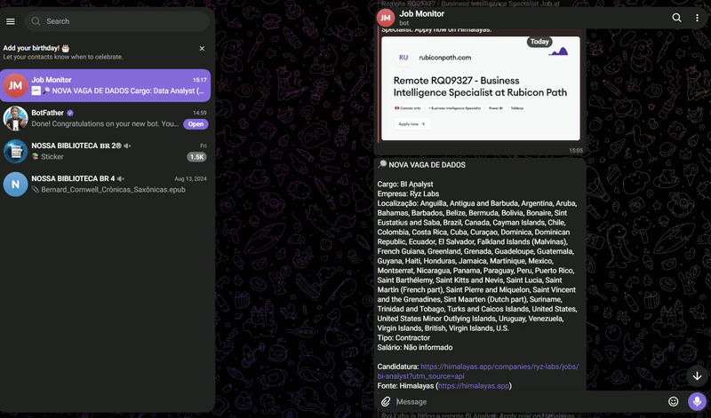

# Job Monitor — Monitor de vagas remotas em Dados

Automação em Python que consulta a API pública da Himalayas, filtra vagas de Dados/BI, padroniza os dados JSON, evita duplicidades com SQLite e envia notificações pelo Telegram (opcional).

## Fonte de dados

Este projeto utiliza a **Himalayas Remote Jobs API**:

- Endpoint: `https://himalayas.app/jobs/api/search`
- API pública e gratuita, sem chave ou cadastro obrigatório.
- Pesquisa por palavra-chave e país.
- Dados atualizados aproximadamente a cada 24 horas.

Documentação oficial: https://himalayas.app/api

**Limitação de escopo:** Himalayas é uma plataforma de vagas remotas. Este projeto não coleta vagas presenciais ou híbridas de todos os portais de emprego. A disponibilidade por país depende das restrições informadas em cada anúncio.

## O que o projeto faz

1. Consulta a API da Himalayas por termos relacionados a Dados e BI.
2. Pesquisa nos países configurados.
3. Processa e valida a resposta JSON.
4. Padroniza título, empresa, disponibilidade geográfica, salário, tipo de contrato e link.
5. Filtra cargos relevantes e remove alguns títulos explicitamente sênior/gerenciais.
6. Armazena vagas inéditas em SQLite usando `guid` como identificador único.
7. Envia pelo Telegram as vagas ainda não notificadas, incluindo vagas que ficaram pendentes antes da configuração do bot.
8. Pode executar automaticamente em intervalo configurável.

## Arquitetura

```text
APScheduler (padrão: 24 horas)
          |
          v
   Himalayas REST API
          |
          v
     JSON recebido
          |
          v
Validação + normalização
          |
          v
     Filtro de vagas
          |
          v
 SQLite (deduplicação + pendências)
          |
          v
 Telegram Bot API (opcional)
```

## Tecnologias

- Python 3.10+
- Himalayas REST API
- Telegram Bot API
- SQLite
- Requests
- python-dotenv
- APScheduler

## Requisitos

- Python 3.10 ou superior
- Conexão com a internet
- Não é necessário criar conta ou obter chave para consultar a API da Himalayas.
- Para receber alertas, é necessário criar um bot gratuito no Telegram.

## Configurar o Telegram

1. Abra o Telegram e procure por **@BotFather**.
2. Envie `/newbot`, escolha um nome e um username para o bot.
3. O BotFather fornecerá um token. Copie-o e guarde-o em segurança.
4. Abra a conversa com o bot que você criou e clique em **Iniciar** (ou envie `/start`).
5. Para descobrir seu `chat_id`, abra no navegador, substituindo `SEU_TOKEN` pelo token do bot:

   `https://api.telegram.org/botSEU_TOKEN/getUpdates`

6. Na resposta JSON, procure por `message` → `chat` → `id`. Esse número é seu `TELEGRAM_CHAT_ID`.
7. Coloque o token e o chat ID no arquivo `.env`.

**Importante:** não publique o token, não o envie para outras pessoas e não faça commit do `.env`. Se o token vazar, gere outro pelo BotFather usando `/revoke`.

## Instalação no Windows

Abra o terminal na pasta do projeto e execute:

```powershell
python -m venv venv
.\venv\Scripts\Activate.ps1
pip install -r requirements.txt
Copy-Item .env.example .env
```

Edite o `.env` e preencha `TELEGRAM_BOT_TOKEN` e `TELEGRAM_CHAT_ID`. Os demais filtros podem ser alterados conforme sua preferência.

## Executar uma busca manual

Na raiz do projeto:

```bash
python -m src.main
```

## Iniciar o agendamento automático

```bash
python -m src.scheduler
```

O agendador executa uma busca ao iniciar e depois repete no intervalo definido em `SCHEDULE_HOURS`.

**Por que 24 horas?** A documentação da Himalayas informa que os dados são atualizados diariamente; consultar a cada hora não traz novas publicações na maior parte do tempo e só aumenta o consumo de requisições. O intervalo pode ser alterado, mas a recomendação é manter 24 horas.

## Configurações (.env)

| Variável | Finalidade |
|---|---|
| `COUNTRIES` | Países ISO alpha-2 separados por vírgula |
| `SEARCH_TERMS` | Termos de busca separados por vírgula |
| `MAX_PAGES_PER_SEARCH` | Páginas consultadas por termo/país (20 resultados por página) |
| `SCHEDULE_HOURS` | Intervalo entre execuções |
| `DATABASE_PATH` | Caminho do banco SQLite |
| `TELEGRAM_BOT_TOKEN` | Token fornecido pelo BotFather |
| `TELEGRAM_CHAT_ID` | ID da conversa que receberá os alertas |

Países iniciais: `BR,US,GB,CA`. A pesquisa por país considera oportunidades que aceitam candidatos naquele país, incluindo vagas mundiais quando aplicável. Para priorizar apenas vagas que aceitam candidatos no Brasil, configure `COUNTRIES=BR`.

## Processamento de dados

A resposta da API é um JSON com uma lista `jobs`. O programa:

- valida se `jobs` existe e é uma lista;
- extrai `guid`, `title`, `companyName`, `locationRestrictions`, `timezoneRestrictions`, `employmentType`, `minSalary`, `maxSalary`, `salaryPeriod`, `currency`, `applicationLink` e `pubDate`;
- transforma o timestamp de publicação em data ISO;
- padroniza os nomes dos campos;
- filtra os cargos;
- elimina duplicatas com a chave `guid`.

## Banco de dados e notificações pendentes

O SQLite cria automaticamente `data/jobs.db`. A tabela `jobs` armazena os anúncios e a coluna `notified` registra se a notificação foi enviada.

Se o programa já tiver sido executado sem o Telegram configurado, as vagas ficam salvas com `notified = 0`. Depois de preencher as credenciais do Telegram, a próxima execução tenta enviar essas vagas pendentes, sem precisar apagar o banco ou executar a busca de outro jeito. A vaga só é marcada como notificada depois que a API do Telegram confirma o envio.

## Custos

A Telegram Bot API é gratuita para o fluxo de notificações deste projeto. Não há assinatura, cartão ou cobrança por mensagem para enviar alertas comuns pelo bot.

## Segurança

- Credenciais não ficam no código-fonte.
- `.env` está listado no `.gitignore`.
- `.env.example` contém apenas nomes de variáveis e valores vazios.
- Nunca publique tokens ou credenciais no GitHub.

## Tratamento de erros

- Timeout nas requisições HTTP.
- Verificação de status HTTP.
- Tratamento específico para HTTP 429 na consulta à Himalayas.
- Tratamento de erros de rede e JSON.
- Logs no terminal e em `logs/job-monitor.log`.
- Falha ao enviar Telegram não apaga o anúncio nem o marca como notificado; ele será tentado novamente na próxima execução.

## Regras de uso e atribuição

A API da Himalayas exige que a fonte seja identificada e que o link de candidatura (`applicationLink`) seja preservado. As mensagens incluem o link da vaga e a indicação da Himalayas como fonte. Consulte os termos oficiais antes de ampliar ou publicar o projeto: https://himalayas.app/api


## Demonstração



## Próximas melhorias

- Testes automatizados com `pytest`.
- Fila de notificações pendentes e retentativas com backoff.
- Mais termos e regras de relevância por cargo.
- Exportação CSV e painel de acompanhamento.
- Deploy em servidor para executar com o computador desligado.

## Referências

- API Himalayas: https://himalayas.app/api
- Documentação técnica Himalayas: https://himalayas.app/docs/remote-jobs-api
- Exemplos oficiais em Python: https://github.com/Himalayas-App/remote-jobs-api
- Telegram Bot API: https://core.telegram.org/bots/api
- Telegram BotFather: https://t.me/BotFather
